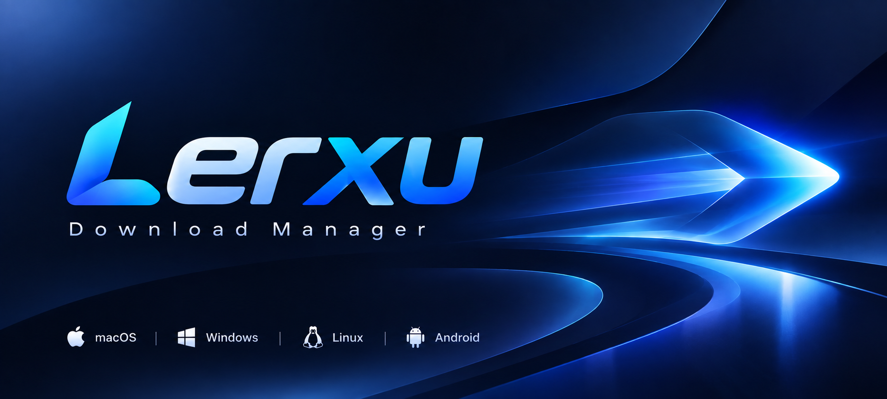
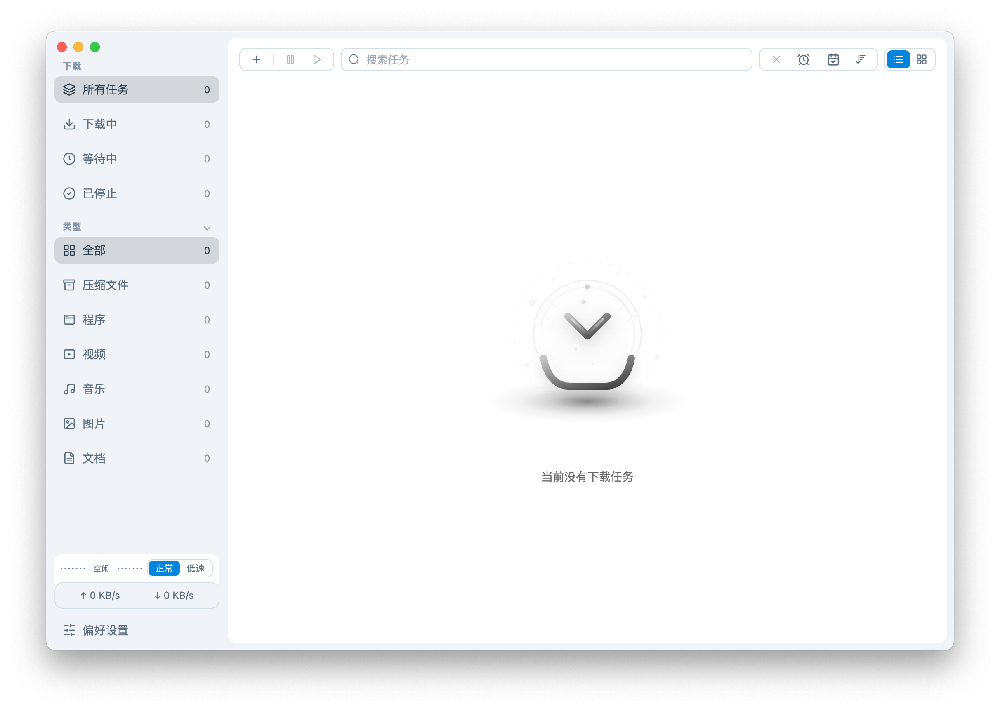
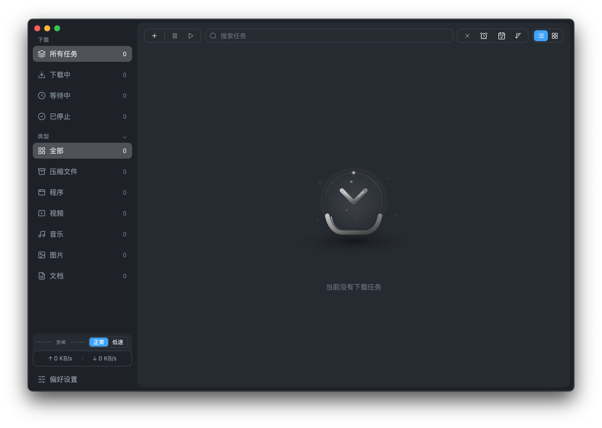

<div align="center">
  <table width="100%">
    <tr>
      <td align="right"><a href="./README-CN.md">中文</a></td>
    </tr>
  </table>
</div>

<p align="center">
  
</p>

<p align="center">
  <a href="https://github.com/MochengCK/Lerxu/releases">
    
  </a>
  <a href="https://github.com/MochengCK/Lerxu/releases">
    
  </a>
  <a href="#supported-platforms">
    
  </a>
  <a href="https://github.com/MochengCK/Lerxu/blob/master/LICENSE">
    
  </a>
</p>

## Introduction

Lerxu is a download manager for Windows, macOS, Linux and Android, powered by the in-house XferRust engine (native Rust). It handles **HTTP(S)**, **BitTorrent** (including magnet links), **HLS (M3U8)** and **SFTP** tasks. On desktop it pairs with a browser extension that detects web videos; the Android client ships its own browser with resource sniffing and a native player.

## Screenshots

<table>
  <tr>
    <td align="center" width="50%">
      
      <p><em>Light Mode</em></p>
    </td>
    <td align="center" width="50%">
      
      <p><em>Dark Mode</em></p>
    </td>
  </tr>
</table>

## Features

### Downloads

- **Protocols**: HTTP/HTTPS, BitTorrent, magnet links, HLS (M3U8) and SFTP; FTP and Metalink are not supported
- **Concurrency**: up to 128 segments per task (32 connections per server by default) and 10 concurrent tasks by default, both adjustable in Preferences
- **HLS**: the playlist and its segments are handled by the downloader and spliced into a single file; bitrate variants, AES-128 encrypted segments, segment concurrency, retries and resume are supported
- **SFTP**: single-file downloads over `sftp://` with parallel connections and resume; log in with a password or an OpenSSH private key, first-seen host keys are recorded and a changed fingerprint is rejected; the private key, passphrase, known-hosts file, connection count and timeout are configurable in Preferences
- **BitTorrent**: uTP/TCP dual stack (hot-switchable), DHT (IPv4/IPv6), LPD, PeX, UPnP/NAT-PMP port mapping and encryption; pre-configured trackers with scheduled subscription updates; ratio- and time-based seeding goals; 128 peer connections per torrent by default
- **Task handling**: priority, batch operations, speed limits, scheduled start/pause with an action on completion (shut down, sleep, quit) and resume; the download process restarts automatically after an abnormal exit and restores task state
- **File handling**: automatic categorization by type, user-defined rules, favorite and recent directories, a custom suffix for in-progress files, and an option to set file modification time to the completion time
- **Request control**: per-task `Referer`, `User-Agent` and arbitrary headers; system or custom proxy applied per scope (downloads, app updates, tracker updates); optional antivirus or custom scanner after completion
- **Link takeover**: `ed2k://` and `thunder://` links are recognized and handed over (`thunder://` decodes to a plain HTTP download, off by default); `ed2k://` is recognition only, native ED2K downloading is not implemented
- **Also**: clipboard auto-paste, drag-and-drop, advanced option presets, custom shortcuts, completion notifications

### Video Download

- **Browser extension**: detects web videos and creates tasks in one click; works in Chromium-based browsers and Firefox
- **Download takeover**: download links on web pages can be handed over to Lerxu, with site and file-type exclusions and a shortcut to bypass temporarily
- **Video detection**: DASH audio and video streams are downloaded separately and merged; an HLS playlist is handed over as one task instead of being expanded into segments
- **Merge progress**: audio/video that needs merging enters a "merging" state with live progress, and multiple segmented videos sent at once still merge correctly

### Android Client

- **Built-in browser**: tabs, history and pull-to-refresh, so you can switch between the downloader and the browser at any time
- **Resource sniffing**: media addresses found while browsing are collected in a resource panel and sent to the downloader in one tap
- **Native player**: fullscreen playback, double-tap seek, playback speed and aspect ratio, looping, keep-screen-on and a screen lock; the player can hand the current video (with filename and estimated size) to the downloader
- **Incognito and blocking**: incognito windows with a separate identity, gated behind biometric or device-password authentication; ad requests are blocked and ad slots hidden by default
- **System integration**: picks a reachable search engine for the current network, can register as the system default browser for http / https links, and lets you choose whether the app opens into the downloader or the browser

### Interface and Experience

- Dark, light and system-following themes; background images or solid colors, UI opacity and frosted glass (native macOS Vibrancy)
- Custom title bar on Windows / Linux; preferences embedded in the main window for faster startup
- Task details drawer (overview, activity, trackers, peers, files and the BT piece map), standalone progress window and a completion dialog
- Download and upload speeds in both the macOS tray and Dock icons; system tray menu and download notifications
- Languages: Simplified Chinese, Traditional Chinese and English

### Updates and Integration

- **Update channels**: stable, preview or all releases, with automatic installation once the package is downloaded
- **Local RPC service**: an optional JSON-RPC endpoint so external tools can drive the same download process
- **Engine info**: the current engine, its version, architecture and the capability list it reports

## Supported Platforms

- **Windows** 10 / 11, x64
- **macOS** Intel x64, Apple Silicon arm64
- **Linux** x64, arm64
- **Android** arm64 (ships a built-in browser besides the downloader, can be set as the system default browser, and has its own update channels)

## Installation

All packages are published on [GitHub Releases](https://github.com/MochengCK/Lerxu/releases).

### Windows

Download `Lerxu-Setup-<version>.exe` and run the installer.

### macOS

Download `*.dmg` (or `*-mac.zip`): open the dmg and drag the app into `/Applications`, or unzip and move it there. If macOS reports an unverified developer on first launch, click "Open Anyway" under "System Settings → Privacy & Security", or right-click the app in Finder and choose "Open".

### Linux

- **AppImage (recommended)**: download `*.AppImage`, then `chmod +x Lerxu-*.AppImage` and run it
- **Debian / Ubuntu**: `sudo dpkg -i lerxu_*.deb`, followed by `sudo apt -f install` if dependencies are missing

### Android

Download `app-release.apk` and install it. `arm64-v8a` devices only.

## Development

Requirements: Node.js 22.12.0 or newer, npm, Git.

```bash
npm install      # install dependencies
npm run dev      # development mode (hot reload)
npm run build    # build installers for the current platform (release/)
npm run lint     # ESLint
```

Extra requirements for the Android client and the browser extension, the remaining scripts, tests and
CI are covered in the [developer documentation](docs/DEVELOPMENT.en.md).

## Contributing

Issues and pull requests are welcome: fork the repository, create a branch, make your changes and open a
PR. Please follow the existing code style, keep commit messages concise, and add tests and documentation
where they are needed.

## Acknowledgments

- Based on the agalwood open-source project [Motrix](https://github.com/agalwood/Motrix), with extensive modifications and feature extensions
- UI: [Vue.js](https://vuejs.org/) + [Element Plus](https://element-plus.org/)
- Desktop: [Electron](https://www.electronjs.org/)
- Download engine: [XferRust](https://github.com/MochengCK/XferRust) (in-house Rust engine)

## Support

- Open an [issue](https://github.com/MochengCK/Lerxu/issues/new/choose)
- Join the community for discussion and support

## License

Released under the [Apache License 2.0](LICENSE).
